# 版本演进 / Version history

每个版本相比上一版改了什么、为什么改、效果如何。逐项技术细节、实测数据和已知问题见 [CHANGELOG.md](CHANGELOG.md)；每个版本都有同名 git 标签（如 `git checkout v0.2.0`）。

## 一览

| 版本 | 日期 | 提交 | 主题 | 起因 |
|---|---|---|---|---|
| v0.1.0 | 11-24 | `07e30f1` | 首个可玩版本 | 按设计方案从零实现 |
| v0.2.0 | 11-24 | `53771a5` | 福田绕行、350 km/h、白天 | 首轮试玩：“一整条大直道开到底”“速度太低”“看不到轮子”“天空亮一点” |
| v0.2.1 | 11-24 | `f5cd7c8` | 原厂轮距、去掉红色航空灯 | “不必强求看到轮胎”“上面红色的灯有点奇怪” |
| v0.2.2 | 11-24 | `e50168d` | 版本号、小地图、暂停、录像、APEC 广告 | “标注版本”“需要小地图”“能重置 / 暂停”“加录像”“加入 APEC 元素”“黑夜版本有点丑” |
| v0.3.0 | 11-24 | `e8f4860` | 真实深圳建筑、国标路牌、小叶榕 | 用另一代理找到的公开深圳 3D 资产提升真实感 |
| v0.3.1 | 11-24 | `f58d891` | 撞墙次数统计 | “统计撞了几次墙，先不加罚时” |
| v0.3.2 | 11-25 | `bdf059d` | 遗留优化 8 项 | “当时做得有点赶，没上的优化继续上” |
| v0.4.0 | 11-26 | `176a12f` | 车内视角、完整真实路线 | “加一个驾驶员坐在车里的第一人称视角，能自由切换”“玻璃不透明度再低一点”“路线变回完整、真实的路线，不需要减去直道” |
| v0.4.1 | 11-26 | `0846ffa` | 撞墙分档与受损 | “撞墙次数在上方时间表上也显示”“高速撞墙应该要很久才能缓过来，普通撞墙还好” |
| v0.4.2 | 11-26 | `01e5203` | 撞墙罚时 | “轻撞不 count，只看重撞和最严重的撞击”“最终成绩 = 实际用时 + 罚时：严重 10 秒、重撞 5 秒” |
| v0.4.3 | 11-26 | `2c456f4` | 自动录像默认关闭 | “自动录像可以默认设成关” |
| v0.5.0 | 11-26 | `f2c673c` | 真实优先：真实高度、真实轮廓、真实横断面 | “按 plan-v0.5.0 把游戏改得更真实”：有数据来源的优先于估算和美术调整，地标被挡也接受 |

## 关键指标随版本变化

| 指标 | v0.1.0 | v0.2.0 | v0.2.2 | v0.3.0 | v0.3.2 | v0.4.0 | v0.5.0 |
|---|---|---|---|---|---|---|---|
| 路线长度（真实长度占比） | 9.66 km（72%） | 12.28 km（76%） | 同左 | 同左 | 同左 | 16.07 km（100%） | 同左 |
| 转弯 | 1 | 4 | 4 | 4 | 4 | 4 | 4 |
| 检查点 | 6 | 8 | 8 | 8 | 8 | 10 | 10 |
| 极速 | 180 km/h | 350 km/h | 同左 | 同左 | 同左 | 同左 | 同左 |
| 圈速 | 脚本驾驶 3:27.94 | 理想估算约 2:53 | 试玩录像 2:36–2:46 | — | — | 理想估算约 3:40 | 同左 |
| 时段 | 黄昏 | 白天 / 日落 / 入夜 | 白天 / 日落 | 同左 | 同左 | 同左 | 同左 |
| 视角 | 车外 | 同左 | 同左 | 同左 | 同左 | 车外 / 车内 | 同左 |
| 真实建筑模型 | 0 | 0 | 0 | 36 | 48 | 49 | 61 |
| 高度有数据依据的建筑占比 | — | — | — | — | — | 60%（OSM 轮廓 68%） | 52%（OSM 轮廓 71%） |
| 虚构建筑 | — | — | — | — | — | 204 栋 + 运行时补楼（322 段里 134 段） | 0 |
| 每帧 draw call / 三角面 | 110–179 / 0.28–0.69 M | 153–197 / 0.37–0.73 M | — | — | 170–243 / 0.55–0.98 M | 205–251 / 0.92–1.07 M | 176–269 / 0.57–1.17 M |
| 单元测试 | 55 | 70 | 85 | 85 | 101 | 106 | 115 |

帧率在各版本实测均为 60 FPS（MacBook Air M5，Chrome）。“—” 表示该版本没有单独测量。v0.5.0 的高度占比按全部 2,192 栋计（新增的 762 栋 Overture 轮廓大多没有高度数据，所以总占比反而低于 v0.4.0）；v0.4.0 的 60% 把 204 栋虚构方块楼也算在内。

## v0.1.0 — 首个可玩版本

- **做了什么**：OSM 真实中心线 + 剪切拼接的深南大道，自由驾驶的 SU7（运动学模型、解析式边界碰撞），检查点、计时、成绩页，程序化立面的 OSM 建筑群和 6 个手工地标，黄昏蓝调，合成电机音效。
- **过程中的修正**：试玩时页面经常被重置（开发服务器随代码改动自动刷新），于是加了只在手动打包时更新的稳定试玩服务（4173 端口）。
- **遗留**：平安金融中心、市民中心、埃菲尔铁塔被路边高楼挡住；一路直道，只在最后转一次弯。

## v0.2.0 — 福田绕行、350 km/h、白天

相比 v0.1.0：
- **路线**：深南大道到益田路后按真实路网绕行福田 CBD，4 处转弯，从平安金融中心脚下经过，在市民中心正立面冲线；全长 9.66 → 12.28 km。
- **地标视廊**：沿视线压低或去掉挡住平安金融中心、市民中心、埃菲尔铁塔的建筑。
- **车辆**：极速 180 → 350 km/h（SU7 Ultra），车轮可见、会滚动和转向，刹车灯。
- **时段**：新增白天和日落，白天立面重做。
- **道路**：转弯路口、指路门架、信号灯、HUD 转弯提示和减速警告。

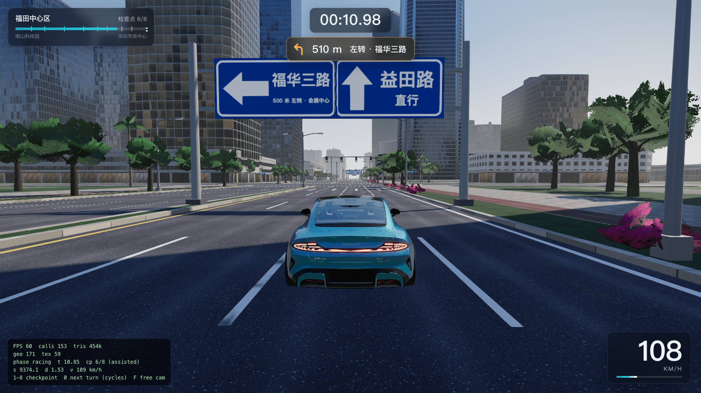

## v0.2.1 — 原厂轮距、去掉红色航空灯

相比 v0.2.0：轮距恢复原厂比例（不再为露出轮胎外扩）；平安金融中心和京基100 顶部的红色闪烁航空灯去掉，塔冠灯保留。

## v0.2.2 — 版本号、小地图、暂停、自动录像、APEC 广告

相比 v0.2.1：
- **界面**：画面角落显示“版本 · 提交 · 日期”；左上角小地图（全程 / 局部，N 切换）；Esc / P 暂停菜单（继续、重新开始、回到检查点、主菜单），失焦自动暂停。
- **自动录像**：从倒计时录到冲线，叠加 HUD 和声音，成绩页可下载 MP4。
- **APEC**：路边广告牌换上 AI 生成的“APEC China 2026 · 相约深圳 见证奇迹”画面，沿线 3 栋大楼外墙挂 APEC 竖屏。
- **时段**：入夜档取消，只留白天和日落。

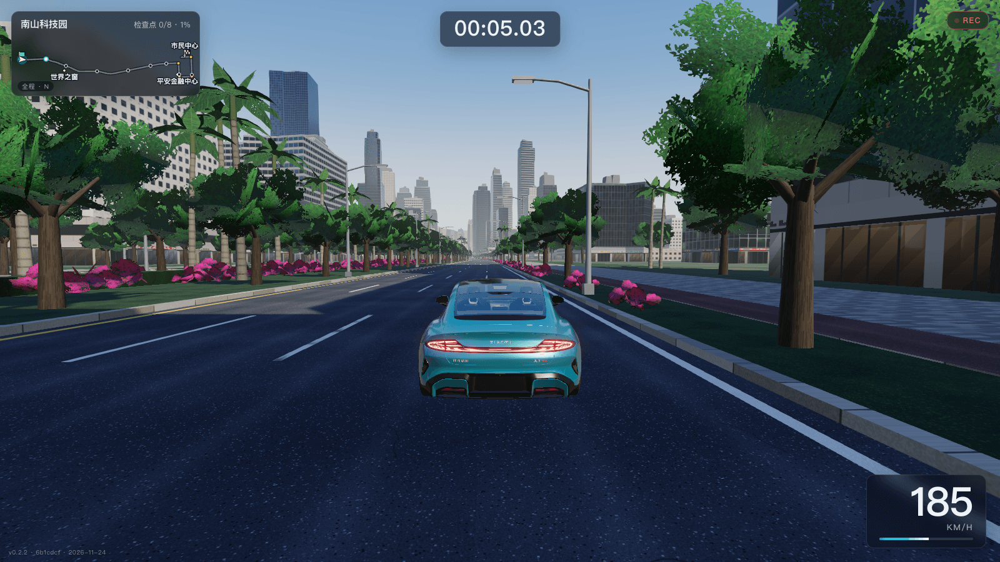

## v0.3.0 — 真实深圳建筑、国标路牌、小叶榕

相比 v0.2.2：
- **真实建筑**：36 栋 3D Warehouse 真实深圳建筑模型按 OSM 轮廓配准后放入游戏，平安金融中心和市民中心由真实模型替换手工地标。
- **路牌**：国标禁令 / 指示牌装在路口和龙门架上。
- **行道树**：小叶榕改为由真实模型烘焙的 impostor，三角面最多降约 26%。

| 改动前（v0.2） | 改动后（v0.3.0） |
|---|---|
| 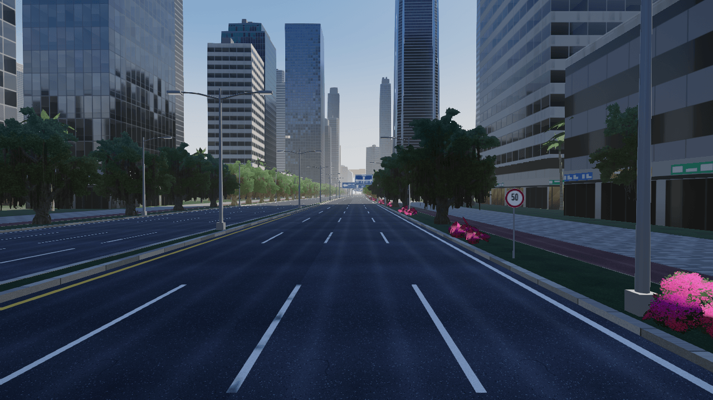 | 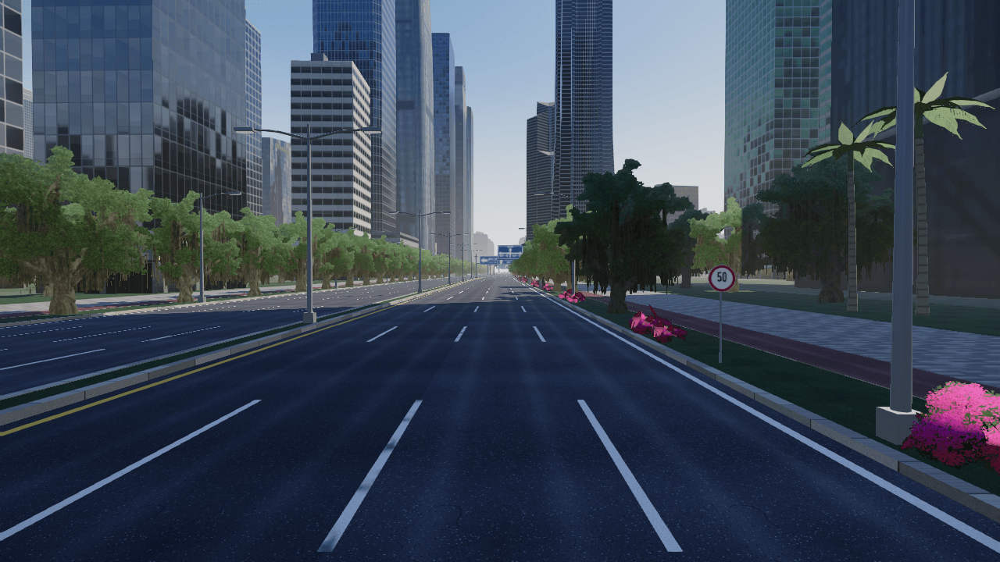 |

## v0.3.1 — 撞墙次数统计

相比 v0.3.0：成绩页显示本局撞墙次数（约 14 km/h 以上的撞击才算，贴墙擦过算 1 次），不加罚时。

## v0.3.2 — 遗留优化

相比 v0.3.1：
- **驾驶**：轻点方向键后车自动回正一半，横向漂移减半；高速镜头更稳。
- **支路封闭**：15 个路口沿碰撞边界放红白水马，看不见的墙变成看得见的。
- **真实建筑**：腾讯大厦、京基100 换成真实模型（埃菲尔保留手工金色版），新增 10 栋，共 48 栋。
- **APEC**：外墙竖屏换成 3 块朝向来车、高过树冠的独立 LED 大屏。
- **小叶榕**：车附近的树改为立体模型，路过不再跟着转。
- **画面**：日落档 HDRI 车漆反射，平安金融中心远景更清楚，市民中心玻璃墙和屋顶底面修正，白天路面不再泛蓝。

| 改动前（v0.3.1） | 改动后（v0.3.2） |
|---|---|
|  |  |

## v0.4.0 — 车内视角、完整真实路线

相比 v0.3.2：
- **车内视角**：C 键（或开始 / 暂停菜单）在车外追尾和驾驶座第一人称之间切换；从驾驶座能看到 SU7 的方向盘、仪表、中控屏和 A 柱，方向盘随转向转动，镜头随车身俯仰侧倾，转弯时看向弯内。
- **车窗玻璃**：不透明度 0.5 → 0.25、绿色减半，车内往外看更清楚。
- **完整路线**：不再剪掉科技园以东和竹子林至车公庙两段直道，全长 12.28 → 16.07 km（真实长度），检查点 8 → 10（新增科技园、竹子林），最佳成绩重新记录。

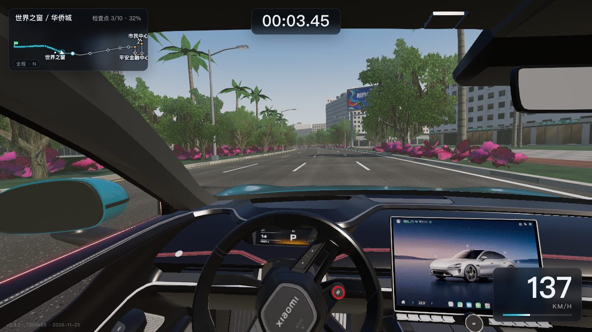

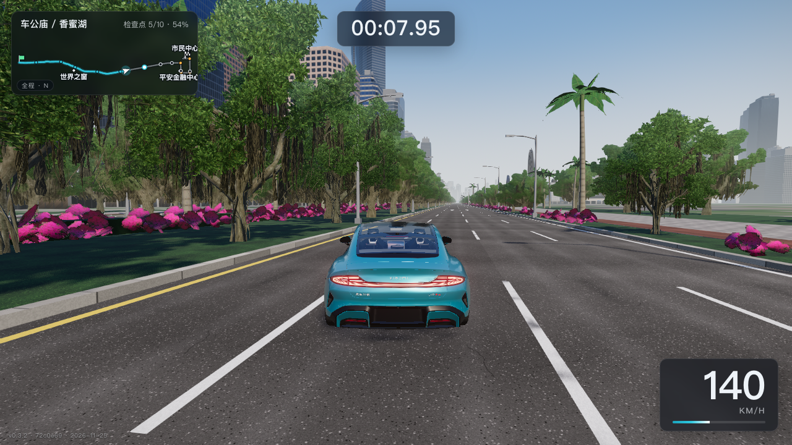

## v0.4.1 — 撞墙分档与受损

相比 v0.4.0：
- **实时计数**：计时面板显示“撞墙 N · 重 M”。
- **分档**：按撞向墙面的速度分量判定强弱，高速轻蹭算轻撞，正面撞墙算重撞或严重撞击。重撞后动力和极速打折、几秒内恢复；严重撞击车当场停住 2 s 再恢复。
- **贴墙不再加速**：贴墙行驶降到约 100 km/h，不能借墙过弯。

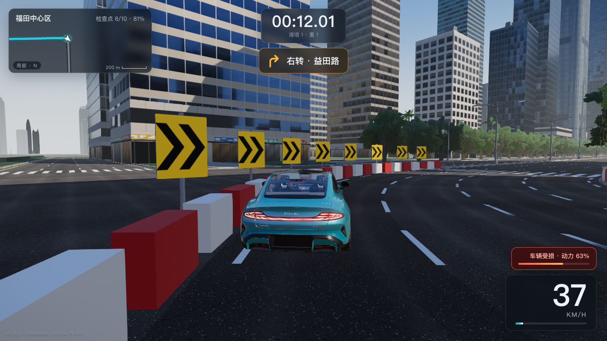

## v0.4.2 — 撞墙罚时

相比 v0.4.1：最终成绩 = 实际用时 + 罚时（重撞每次 +5 s，严重撞击每次 +10 s），最佳成绩按最终成绩比较并重新记录；轻撞不再计数，计时面板显示“重撞 N · 严重 M · 罚时 +X s”。

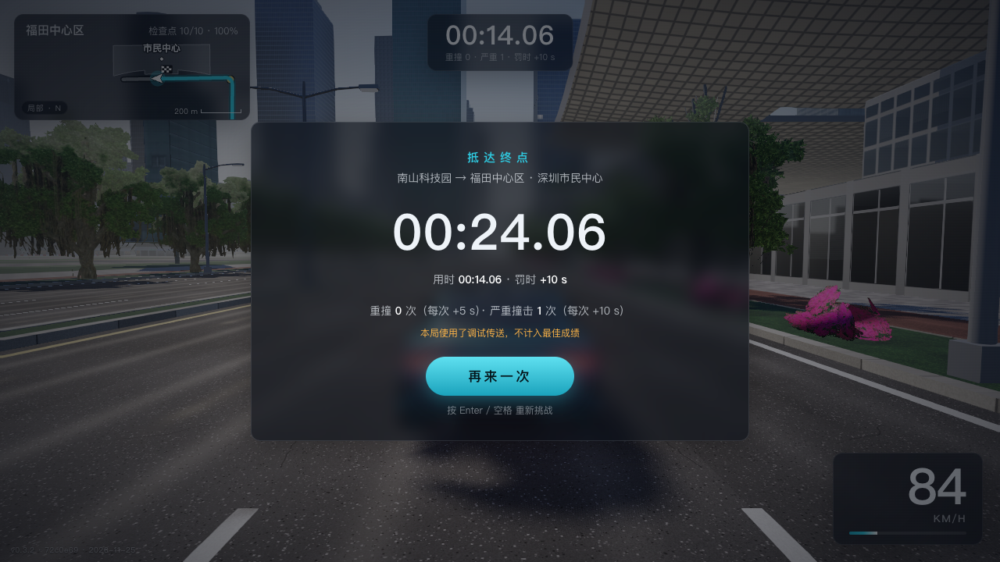

## v0.4.3 — 自动录像默认关闭

相比 v0.4.2：自动录像默认关闭，需要时在开始界面或暂停菜单打开。

## v0.5.0 — 真实优先

相比 v0.4.3（按 [plan-v0.5.0.md](plan-v0.5.0.md)）：
- **不再为地标压低建筑**：取消 4 条地标视廊，77 栋被压低的真实建筑恢复原高度（例：深铁置业大厦 19 → 269 m），21 栋被删除的恢复，之前因挡视线不放的 12 个真实建筑模型放上（共 61 个）；行道树不再压低；地标远景雾效与其他建筑相同。平安金融中心、市民中心、埃菲尔铁塔在部分路段会被真实建筑或行道树挡住，这是有意的结果（被挡程度见 CHANGELOG）。
- **虚构建筑归零**：去掉 204 栋程序化方块楼和运行时补街墙；OSM 缺楼的地方用 Overture 的 762 个机器学习识别的真实屋顶轮廓补上（华侨城东住宅区等），两者都没有楼的空地（世界之窗、竹子林车辆段、香蜜湖施工地）保持空着。
- **建筑高度**：接入 CMAB 中国多属性建筑数据集。它只覆盖福田一侧，而且高楼严重偏矮（平安金融中心没有对应屋顶），校准后只给 178 栋补了高度；知名建筑的高度来自 OSM 和真实模型，抽查 10 栋误差都在 3% 以内。建筑立面按办公、住宅、商业、公共、工业和建成年代选。
- **深南大道横断面**：按 OSM 建出辅路、种着小叶榕和双臂路灯的侧分带、自行车道和人行道；7 座人行天桥、70 个公交候车亭、52 个地铁出入口雨棚按 OSM 位置放置。车行道宽度、碰撞边界和圈速不变。

前四张为同一机位的对比，左 v0.4.3、右 v0.5.0。

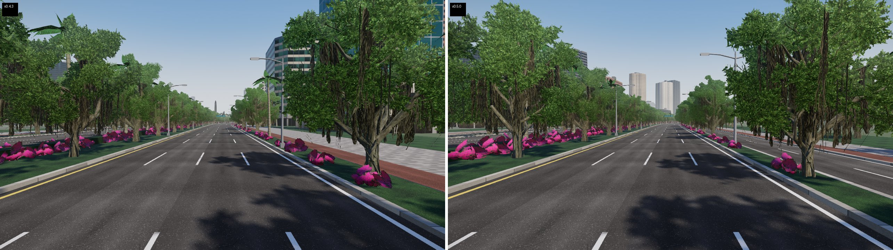

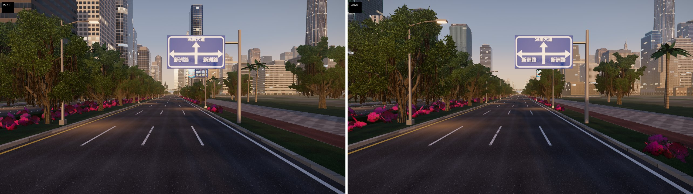

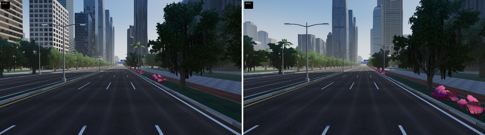

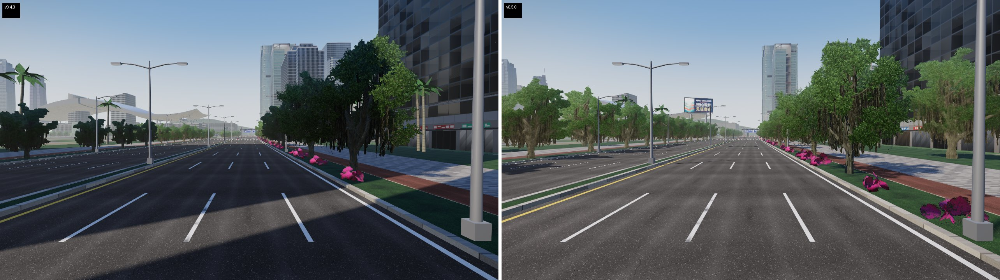

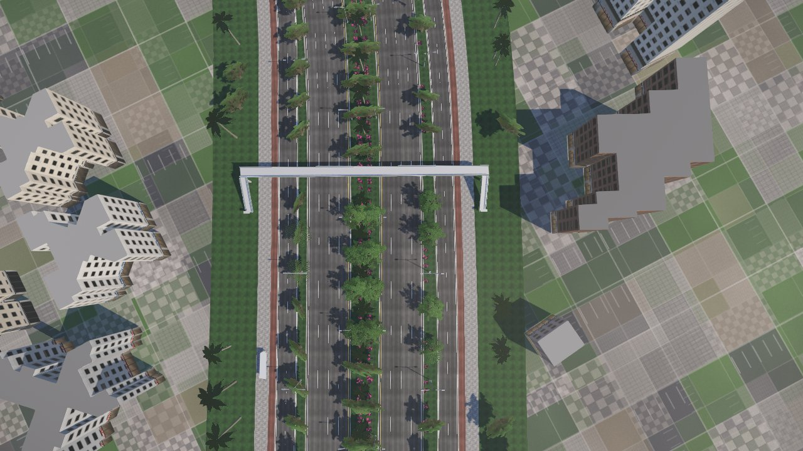

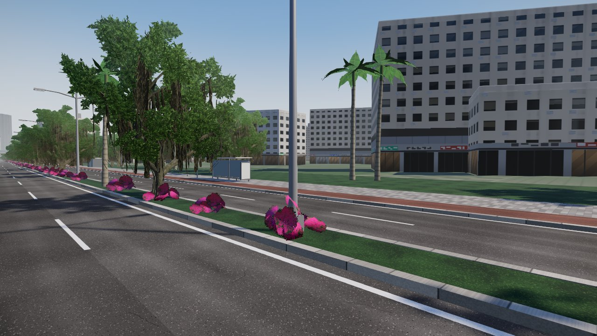

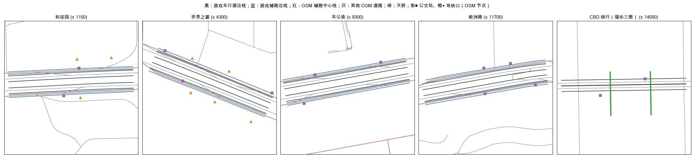

## 尚未解决（截至 v0.5.0）

- 两块 APEC 大屏远处被行道树和门架遮挡。
- 高度有数据依据的建筑只占 52%（OSM 轮廓 71%），离 90% 的目标还远：CMAB 不覆盖南山，覆盖的部分高楼偏矮，其他公开数据源（CMAB Figshare 版、3D-GloBFP）拒绝脚本下载。挡住平安金融中心远景最多的两栋楼高度是估算的。
- 辅路两端直接截断，没有汇入口；横向街道只画 70 m；益田路、金田路仍是平面路口。
- 自动回正强度、撞墙惩罚强度待真人试玩确认。
- 车内视角：仪表和中控屏是静态贴图；车内不接收阴影，车顶和 A 柱不挡阳光。
